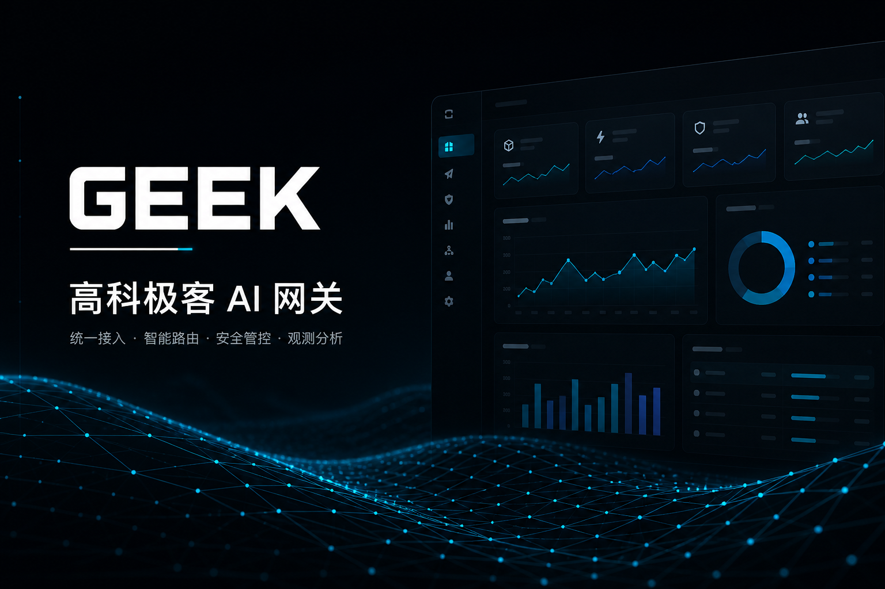
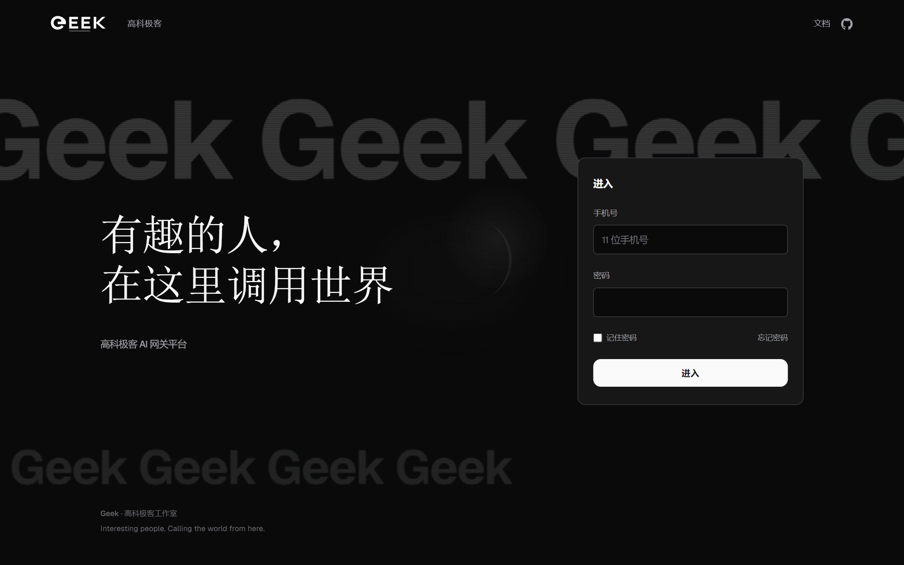
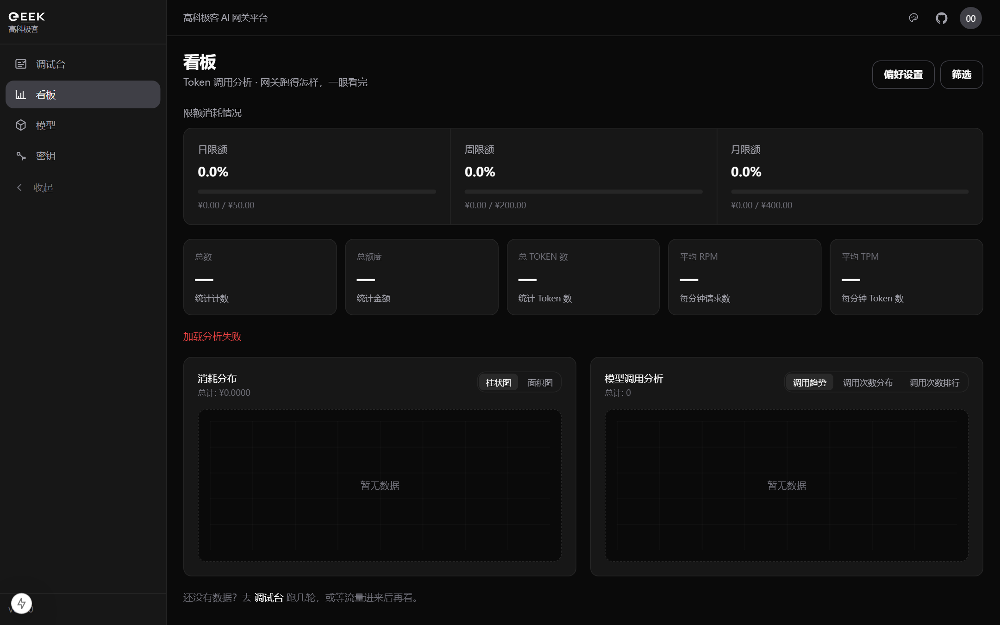
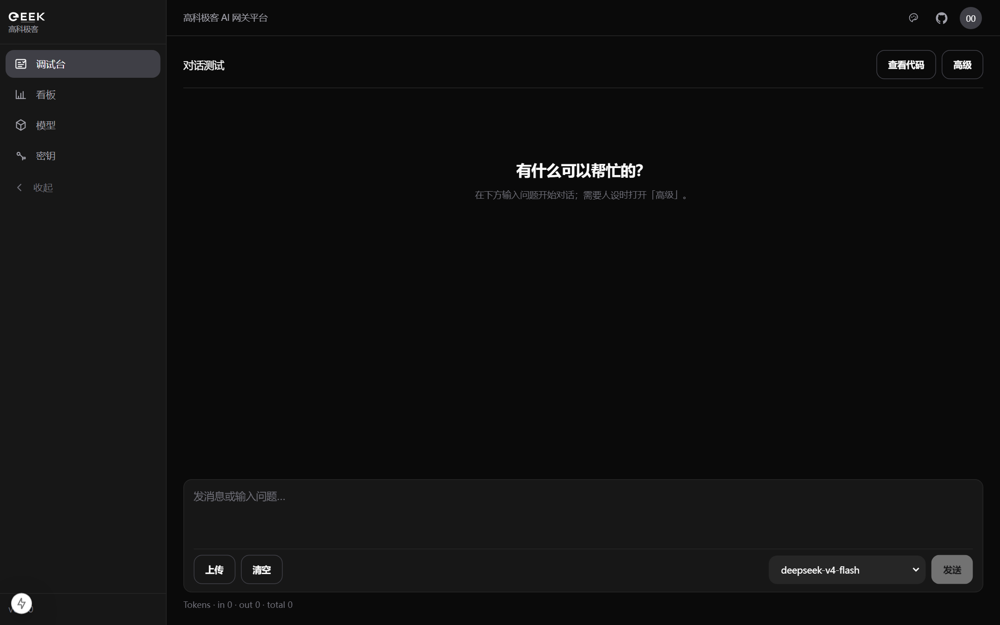
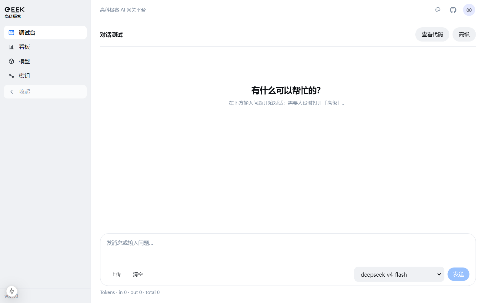
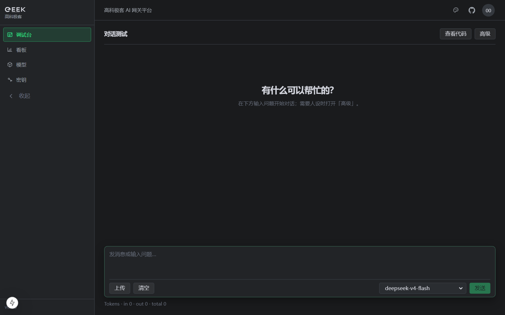
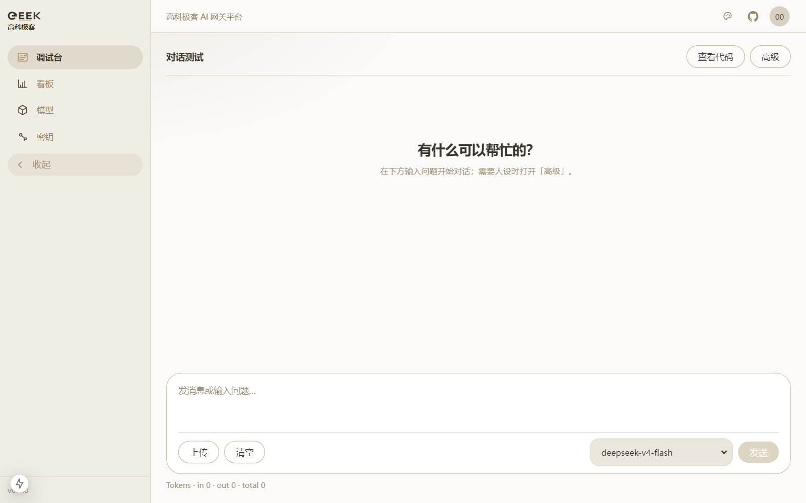
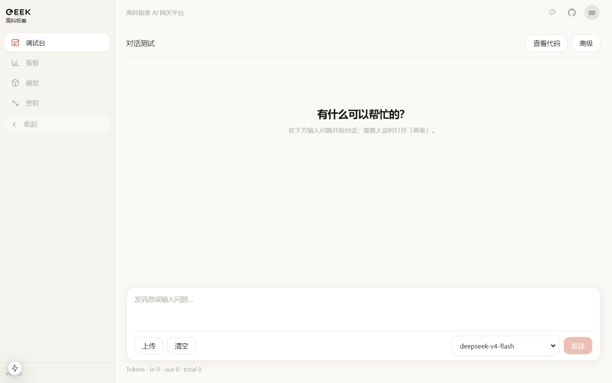
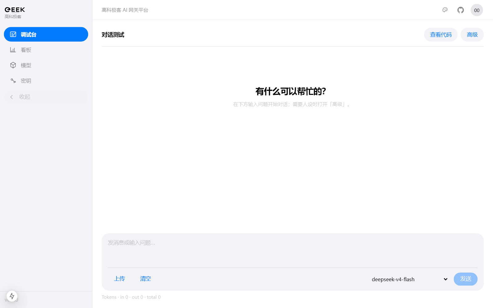
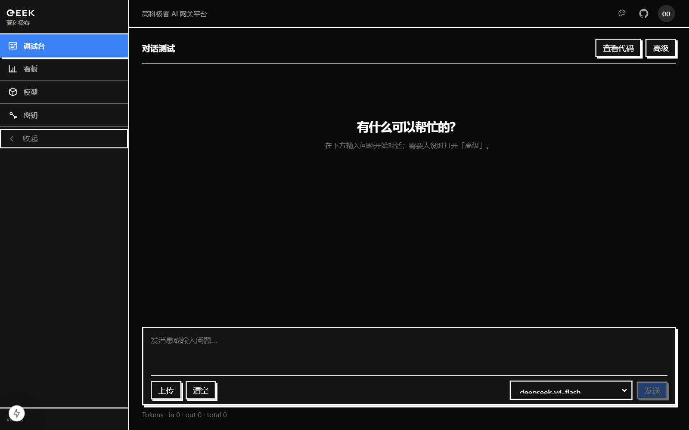

<p align="center">
  
</p>

<h1 align="center">高科极客 AI 网关平台</h1>

<p align="center"><b>有趣的人，在这里调用世界</b></p>

<p align="center">
  OpenAI 兼容的团队 AI 网关<br/>
  统一接入 · Virtual Key · 用量观测 · 调试台 · <b>8 套皮肤</b>
</p>

<p align="center">
  <a href="https://github.com/htt-FAK/Geek-AI-Gateway-Platform"></a>
  &nbsp;
  
  &nbsp;
  
</p>

<p align="center">
  <a href="#product">产品</a> ·
  <a href="#skins">多皮肤</a> ·
  <a href="#features">功能</a> ·
  <a href="#quickstart">快速开始</a> ·
  <a href="#models">模型</a> ·
  <a href="#architecture">架构</a>
</p>

---

## Product

把「接入 → 鉴权 → 计费 → 观测 → 试用」收成一条链路：按需发 Virtual Key，看板看用量，调试台试模型，模型页直接看调用文档。管理员用手机号即可管成员和余额。

<p align="center">
  <br/>
  <sub>进入页 · 品牌钉死，不随皮肤漂移</sub>
</p>

<br/>

<p align="center">
  <br/>
  <sub>用量看板 · 账户余额与 Token 趋势</sub>
</p>

<br/>

<p align="center">
  <br/>
  <sub>调试台 · 流式对话、思考深度、调用示例</sub>
</p>

<div align="center">

| 以前 | 现在 |
|:----:|:----:|
| 每人一把上游 Key | 统一 Virtual Key，可轮换、可禁用 |
| 不知道谁在烧钱 | 日 / 月预算 + Token 看板 |
| curl 试模型靠猜 | 调试台 + 模型文档弹层 |
| 控制台千篇一律 | **8 套皮肤**，气质一眼可辨 |

</div>

---

## Skins

控制台支持 8 套深度定制皮肤（侧栏 / 按钮 / Composer / 字体整套切换）。进入页始终保持品牌样式。

<p align="center">
  
  &nbsp;
  
</p>
<p align="center">
  <sub>Doubao（浅）&nbsp;&nbsp;·&nbsp;&nbsp;TRAE（深）</sub>
</p>

<p align="center">
  
  &nbsp;
  
</p>
<p align="center">
  <sub>Golden Time&nbsp;&nbsp;·&nbsp;&nbsp;Claude</sub>
</p>

<p align="center">
  
  &nbsp;
  
</p>
<p align="center">
  <sub>Apple&nbsp;&nbsp;·&nbsp;&nbsp;21th</sub>
</p>

<div align="center">

| 皮肤 | 气质 |
|:----:|:----:|
| Minimal | 极简黑白默认 |
| TRAE | IDE 小圆角 · 青绿 / 浅紫 |
| Golden Time | 暖纸衬线 · 金色胶囊 |
| Google | Material · 蓝 pill |
| Doubao | 浅灰侧栏 · 白底选中 |
| Claude | 纸感 · 陶土圆角 |
| Apple | 毛玻璃 · System Blue |
| 21th | 直角硬阴影 · 电蓝 |

</div>

---

## Features

- **统一网关** — OpenAI 兼容 `/v1`；DeepSeek、小米 MiMo、阿里云百炼（千问 / Kimi / 智谱 / MiniMax / 阶跃）、硅基流动、讯飞星火。DeepSeek 峰时计费可配（工作日峰时 ×2，周末 / 节假日错峰）  
- **控制台** — 手机号登录、预算、用量曲线、模型文档  
- **成员管理** — 角色管理员用手机号登录即可导入、充值、禁用、重发密钥；成员用量覆盖全部账号，看累计充值、剩余余额和本期 Token（与 `ADMIN_TOKEN` 并行）  
- **多密钥管理** — 阿里云式 API Key 面板：创建 / 查看 / 复制 / 编辑 / 删除，描述 / 有效期 / 按 Key 选模型 / 预算。新账号默认没有 Key  
- **模型广场** — 按厂商和用途（文本 / 语音 / 知识库向量）筛选；卡片带免费标识；详情页含价格、限流与上下文、能力矩阵、调用示例  
- **模型榜单** — 模型 × 思考档位的智能 / 速度 / 延迟 / 价格对比（Artificial Analysis 公开数据，含千问、Kimi、GLM）  
- **调试台** — 流式输出、思考深度、附件、cURL / SDK 示例  
- **多皮肤** — 8 套整站气质；侧栏几何统一；进入页品牌钉死  
- **一键运维** — `deploy/` Compose + `scripts/deploy.sh` / `test.sh` / `local-postgres.sh`

<div align="center">

| 入口 | 本机 | 线上（HTTPS 反代） |
|:----:|:----:|:----:|
| Web | `http://localhost:3000` | `https://<host>` |
| API | `http://localhost:4000/v1` | `https://<host>/v1` |

线上只把 OpenAI 兼容的 `/v1` 反代到网关，`/key`、`/user`、`/spend` 等管理端点仍只绑回环。`litellm` 只是 Compose 内部服务名，不会出现在对外地址里。

</div>

---

## Quickstart

<details>
<summary><b>本机开发（Windows）</b></summary>

```powershell
# 网关
cd gateway
copy .env.example .env   # 填入上游 Key
# docker compose up -d   或 litellm --config ./config.yaml --port 4000

# Web
cd ../web
copy .env.example .env   # GATEWAY_BASE_URL=http://127.0.0.1:4000（无 /v1）
npm install
npx prisma migrate deploy
npm run dev
```

打开 http://localhost:3000/login

**多密钥管理（可选）**：需要 LiteLLM 密钥库（Postgres）。无 Docker 时可用免安装二进制：

```bash
# 下载 PostgreSQL 16 windows-x64-binaries zip，解压到纯英文路径（中文路径会导致 initdb 失败）
# 默认 C:/Users/Public/aigw-pgsql，可用 PGROOT 覆盖
./scripts/local-postgres.sh init     # 初始化 + 启动 + 建库（仅监听 127.0.0.1）
./scripts/local-postgres.sh status   # start / stop 同理
# gateway/.env 设 DATABASE_URL=postgresql://litellm@127.0.0.1:5432/litellm 后重启网关
# 首次需 pip install prisma 并 python -m prisma generate --schema <litellm/proxy/schema.prisma>
```

DB 在线时控制台「密钥」页支持创建多把 Key（描述 / 有效期 / 按 Key 选模型 / 预算）。
新账号默认不发 Key。明文在创建时加密留存本地（`ApiKeyLocal` 表），支持随时查看 / 复制。
IP 白名单为 LiteLLM 企业版功能，本地免费版不提供。

</details>

<details>
<summary><b>服务器一键部署（Linux + Docker）</b></summary>

```bash
chmod +x scripts/*.sh deploy/web-entrypoint.sh
./scripts/env-init.sh
# 编辑 deploy/.env
./scripts/deploy.sh && ./scripts/test.sh
```

腾讯云 CVM/轻量完整流程（地域备案、HTTPS 反代、国内镜像源、数据迁移、备份）见 [`docs/部署-腾讯云.md`](docs/部署-腾讯云.md)。

</details>

<details>
<summary><b>Windows 生产纳管（PM2 进程守护）</b></summary>

```bash
npm install -g pm2
cd web && npm run build && cd ..   # 生产构建（勿与 npm run dev 同时跑）
./scripts/pm2-up.sh                # Postgres → 网关 :4000 → Web :3000，kill 自动拉起
./scripts/pm2-boot-install.sh      # 开机自启（登录触发，无需管理员）
pm2 status && pm2 logs             # 状态 / 日志（logs/pm2-*.log）
```

完整运维口径（健康检查、计费对账、踩坑、备份、年度维护）见 [`docs/运维手册.md`](docs/运维手册.md)。

</details>

---

## Models

<div align="center">

| 渠道 | Model | 说明 |
|:----:|:-----:|:----:|
| DeepSeek | `deepseek-flash` | 更快更省 · 图像理解 · 峰时 ×2 |
| DeepSeek | `deepseek-v4-pro` | 旗舰 · 思考档 |
| 小米 MiMo | `mimo-v2.6-pro` / `*-flash` | 全模态 · 思考档 |
| 小米 MiMo | `mimo-v2.5-asr` / `*-tts*` | 语音识别 / 合成 |
| 阿里云百炼 | `qwen4-max` / `qwen3.8-flash` | 千问 · 图像 / 视频 |
| 阿里云百炼 | `kimi-k3.1-pro` | 月之暗面 · 默认思考 |
| 阿里云百炼 | `glm-5.3` / `glm-5.3-flash` | 智谱 |
| 阿里云百炼 | `minimax-m3.1-flash` / `step-5-preview` | MiniMax · 阶跃 |
| 硅基流动 | `xing4.0-29b` / `qwen3.5-4b` / `bge-*` | 星辰、OCR、向量与重排 · 限时免费 |
| 讯飞星火 | `spark-x2.6` | 限时免费 |

</div>

```bash
curl "$GATEWAY/v1/chat/completions" \
  -H "Authorization: Bearer $AI_GATEWAY_API_KEY" \
  -H "Content-Type: application/json" \
  -d '{"model":"deepseek-flash","messages":[{"role":"user","content":"Hello"}]}'
```

价格与 `gateway/model_catalog.json` 一致（人民币 / 百万 token）。控制台 **模型** 可按厂商、用途筛选，点进卡片看官方说明与完整示例。限时免费模型在卡片上单独标出。

---

## Architecture

```text
Browser ──session──► Next.js Web (BFF)
                          │
                          ▼
                    LiteLLM Proxy :4000/v1
            ┌──────────┼───────────┬──────────┐
       DeepSeek     MiMo        百炼      硅基流动 / 讯飞
```

```text
deploy/   Compose · Web 镜像
gateway/  LiteLLM · 峰谷价 · catalog
web/      控制台 + BFF
scripts/  env-init · deploy · test
docs/     交接 · README 截图
```

本仓库是精简业务仓，**不含** LiteLLM monorepo 源码（镜像 `v1.83.14-stable`）。

---

## 计费与限流边界

**余额口径（三处同一本账）**：余额 = `User.balanceGrantedCny` − 网关用户级 `spend`
（`/user/info`，覆盖控制台与全部 Virtual Key 直连）。个人看板按 `user_id` 拉
`/spend/logs/v2` 聚合，管理端剩余复用 `getBalance`；网关离线时回退本地 `SpendEvent`
并在响应标明口径（`mixed_fallback` / `spend_event_fallback`）。日志超 5000 条标
`litellm_truncated`，前端提示曲线不完整。

**单笔超支是固有口径**：余额门在调用前检查，网关 `max_budget` 也按已入账 spend 比较，
不做预扣——余额剩几分钱仍可打完一轮。单笔超支上限 ≈ `max_tokens`（上限 128000）×
模型输出价。并发超支由两层压制：BFF 每用户在途请求 ≤3（`/api/chat` 与调试台共享槽位），
网关用户级 `rpm_limit`（`GATEWAY_USER_RPM_LIMIT`，默认 60/分，`GATEWAY_USER_TPM_LIMIT`
可选）覆盖该用户全部 Key 含直连。充值为条件更新（CAS）＋按用户互斥锁，控制台自愈
回写在锁内重读最新余额，不会盖掉充值后的网关预算。

**单机边界**：登录/对话限流计数与 post-turn 整理队列都在进程内存，应用库为 SQLite
（单写者）。多 Web 副本或重启会清零计数、队列不共享——多副本部署前需把限流计数迁到
Redis/Postgres、整理队列换持久化队列，应用库换 Postgres。上游各家共用一把 Key，
用户级 RPM 只防单人打满，上游档位耗尽仍会全体 429（BFF 已区分翻译）。

---

## Docs & Security

<div align="center">

| 文档 | 路径 |
|:----:|:----:|
| 运维手册 | [`docs/运维手册.md`](docs/运维手册.md) |
| 腾讯云部署 | [`docs/部署-腾讯云.md`](docs/部署-腾讯云.md) |
| 后续工单 | [`docs/后续工单-生产就绪.md`](docs/后续工单-生产就绪.md) |
| 交接 | [`docs/实现交接-手机号登录与网关.md`](docs/实现交接-手机号登录与网关.md) |
| 开发 | [`AI网关平台-开发文档.md`](AI网关平台-开发文档.md) |
| 截图 | [`docs/images/`](docs/images/) |

</div>

- 切勿提交真实 Key；只用 `*.env.example`  
- 内部项目，未声明开源协议前请勿擅自分发敏感配置

---

<p align="center">
  <sub>Geek · 高科极客工作室 · Interesting people. Calling the world from here.</sub>
</p>
