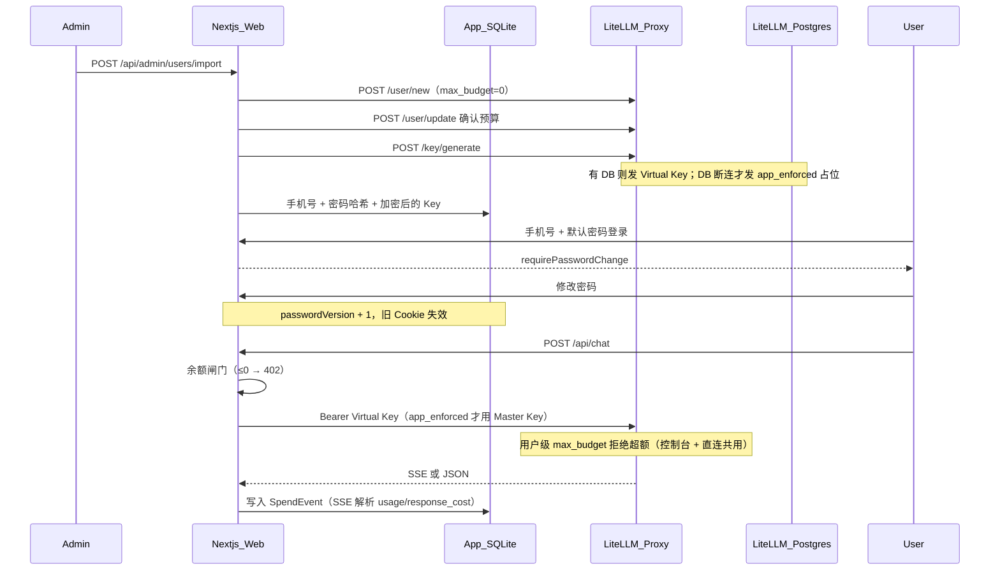

# 实现交接文档：手机号登录 + LLM 网关

> 仓库：`Geek-AI-Gateway-Platform`  
> 修订：2026-11-18（余额模型重写。旧版里的日/周/月限额、路径和「未做」清单已失效，不要再按它改）  
> 业务入口只有两处：`gateway/`（LiteLLM 配置）和 `web/`（Next.js 控制台 / BFF）。不要改 LiteLLM 源码；运行时用官方镜像 `v1.83.14-stable` 挂载 `gateway/`。  
> 生产缺口的工单清单见 [`后续工单-生产就绪.md`](./后续工单-生产就绪.md)。本文是代码核对后的现状，和工单有重叠，以代码为准。

---

## 1. 现在要解决什么

团队共用 DeepSeek、小米 MiMo，不把上游 Key 发给个人：

- OpenAI 兼容入口（LiteLLM Proxy，`:4000/v1`）
- 人民币价目、Spend Logs、DeepSeek 峰时 ×2
- 自研登录和调试台（不用 LiteLLM Admin UI 当产品登录页）
- 管理员预导入手机号；共用默认密码；首登强制改密
- **纯余额制**：每个用户一份终身余额（累计充值 − 累计花费），网关用**用户级** `max_budget` 卡住该账号的全部 Virtual Key
- 每用户一把主 Virtual Key，供调试台代理；密钥页还可以再发额外 Key

明确不做：短信验证码、开放自助注册、SSO、充值 / 发票（管理后台手工充值）。

| 目录 | 职责 | 端口 |
|------|------|------|
| `gateway/` | 模型、价目、峰谷 callback、仅网关的 Compose | `4000` |
| `web/` | 账号、Session、余额闸门、调试台、看板、密钥、皮肤 | `3000` |
| `deploy/` | 网关 + Web 一起的 Compose | `3000` 与 `4000` |
| `scripts/` | `env-init.sh`、`deploy.sh`、`test.sh` | — |

---

## 2. 计费模型（先读这个）

```
余额 = balanceGrantedCny（累计充值） − spend（累计花费）      balanceUnlimited = true 时无上限
花费优先取网关用户级 spend（/user/info，覆盖控制台 + 直连两条路径）；网关失败回退本地 SpendEvent 合计
```

- `User.balanceGrantedCny` 是**累计充值**，只增不减；新用户默认 0。`balanceUnlimited` 表示测试账号不限额。
- 网关侧规则：同一个 `litellmUserId`（`phone:<手机号>`）上设 `max_budget = balanceGrantedCny`（终身上限，不设 `budget_duration` → 永不重置），该账号全部 Key 共享。`balanceUnlimited = true` 时 `max_budget: null`。LiteLLM 的规则是 `spend >= max_budget` 就拒绝。
- **不要**把 `max_budget` 设成「剩余余额」：网关自己会用累计 spend 去减，再设成剩余会双扣。
- 日 / 周 / 月限额已删除。`web/src/lib/env.ts` 不再读 `DAILY_BUDGET_CNY` / `WEEKLY_BUDGET_CNY` / `MONTHLY_BUDGET_CNY`，也不要加回来。
- 余额闸门（`web/src/lib/budget.ts` 的 `assertHasBalance`）在 `/api/chat` 入口返回 402「余额不足」；直连网关由 LiteLLM 的用户级 `max_budget` 拒绝。两道闸共用同一份数据。

### 2.1 失败语义（本地与网关必须同成同败）

| 操作 | 语义 |
|------|------|
| 导入用户 | 必须传 `{ grantedCny: 0, unlimited: false }`；`ensureLitellmUserAndKey` 在发 Key **之前**确认网关 `max_budget=0` 写入成功，失败就抛错进 `errors`，不留无预算的 Key |
| 充值 / 不限额开关 | **网关先行**：`syncUserBudget` 失败 → 什么都不改，返回 503「网关预算同步失败」；本地事务失败 → 回滚网关到旧值，503 |
| 禁用 / 解禁 | 先把该用户在网关上的全部 Virtual Key 封禁（`/key/block`，解禁用 `/key/unblock`；LiteLLM 用户表没有 `blocked` 字段，只能按 Key 封），解禁同时按当前余额再同步一次 `max_budget`；网关失败 → 不改本地 `disabled`，503 |
| 删除最后一把 Key | 主 Key 字段清空（`litellmKeyTokenEnc/litellmKeyId = null`），`/api/chat` 返回 400。**绝不**写 `__app_enforced__` 哨兵让 Master Key 代发 |
| 重发卡 / 重新生成 | 吊销旧 Key 失败（非「No keys found」）→ 502，不签发新 Key；吊销成功后才签发，且必须写 `ApiKeyLocal` |
| 花费日志查询 | HTTP 失败 / 解析失败返回 `null`（≠ 空数组）。管理端返回 503；个人看板回退本地口径并标注 `mixed_fallback` |

`__app_enforced__` 占位 Key 只有一条合法路径：`/key/generate`（或 `/user/new`）的报错正文明确是数据库没连上（`DB not connected` / `no database` 等）。404 和其它 5xx 一律抛错，禁止发占位 Key。

---

## 3. 数据流



### 3.1 两种 Key 模式

| 模式 | 何时出现 | 调试台鉴权 | 超额拦截 |
|------|----------|------------|----------|
| `virtual_key` | `/key/generate` 成功 | 用户 Virtual Key | 网关用户级 `max_budget`（Web 闸门先行，网关兜底） |
| `app_enforced` | 网关数据库不可用（正文明确） | Master Key，body 带 `user` | Web 用本地 `SpendEvent`（`assertHasBalance`） |

占位串（加密后入库）：`__app_enforced__:phone:13800138000`。它不能当外部 SDK Key。  
Compose 接上 Postgres 后验收要 `REQUIRE_VIRTUAL_KEY=true`。

---

## 4. `gateway/`

```
gateway/
  config.yaml
  model_catalog.json
  callbacks.py
  deepseek_peak.py
  test_deepseek_peak.py
  docker-compose.yml          # 只有 postgres + litellm
  .env.example
  sql/daily_spend_summary.sql
```

对外别名（与 `web/src/lib/env.ts` 的 `GATEWAY_MODELS` 一致）：

```
deepseek-flash
deepseek-v4-pro
mimo-v2.6-pro
mimo-v2.6-flash
mimo-v2.5-asr
mimo-v2.5-tts
mimo-v2.5-tts-voiceclone
mimo-v2.5-tts-voicedesign
```

上游：DeepSeek 用 `deepseek/deepseek-flash`、`deepseek/deepseek-v4-pro`；MiMo 用 `openai/mimo-*`，`api_base` 为 `https://api.xiaomimimo.com/v1`。价目在 `model_info` 里，货币 CNY。改价要同时改 `config.yaml`、`model_catalog.json`、`web/src/lib/model-market.ts`。

峰时（`deepseek_peak.py`）：上海时区，周一至周五 09:00–12:00、14:00–18:00（左闭右开），模型名含 `deepseek` 时 `response_cost × 2`。周末全天错峰。法定节假日表**只维护到 2026 年**——文件头有「每年要换表」注释，每年 11 月要新增 `_holidays_YYYY` 并更新 `PUBLIC_HOLIDAYS`。回调在 spend 落库前改价，Web 不要再乘一次。

`gateway/docker-compose.yml` 起 Postgres（`127.0.0.1:5432`）和 LiteLLM（`127.0.0.1:4000:4000`，仅回环——用户预算在网关上，但 Master Key 不应暴露到公网）。整站用 `deploy/docker-compose.yml`，里面多一个 `web` 服务，默认 `GATEWAY_BIND=127.0.0.1`。

---

## 5. `web/`

### 5.1 技术栈

- Next.js 15.1 App Router、React 19、Tailwind
- Prisma 7 + `@prisma/adapter-libsql`（应用库是 SQLite）
- Session：`jose` HS256，Cookie `gw_session`，httpOnly；记住我 30 天，否则 7 天
- 密码：bcryptjs。改密或管理员重置会把 `passwordVersion` 加 1
- Virtual Key：AES-256-GCM，`CREDENTIALS_ENCRYPTION_KEY` 为 32 字节的 base64

`package.json` 里的 `ai`、`@ai-sdk/openai` 没有被引用。

### 5.2 数据模型

**User**：`phone`（唯一）、`passwordHash`、`mustChangePassword`、`disabled`、`passwordVersion`、`litellmUserId`（`phone:` + 手机号）、`litellmKeyTokenEnc`（主 Key 密文，删除后可为 null）、`litellmKeyId`、`keyRevealedAt`、`balanceGrantedCny`（累计充值，默认 0）、`balanceUnlimited`。

**BalanceTopUp**：充值流水（审计）。充值接口先写网关再写本地，事务内一起落。

**ApiKeyLocal**：多 Key 的明文副本。`litellmToken` 是 `sha256(完整 key)`，用来和 LiteLLM `/key/list` 返回的 `token` 对齐。`keyEnc` 是同一把明文的 AES-GCM。导入、重发卡、重新生成、密钥页创建都会写入。

**SpendEvent**：`costCny`、`model`、`promptTokens`、`completionTokens`、`totalTokens`、`createdAt`。调试台每次成功调用都会插一行；**取消的流式请求只在解析到费用时落一条**，没有费用不写 0 元记录。

应用库默认 `file:./dev.db`。Compose 里是 `file:/data/dev.db`（volume `web_data`）。

### 5.3 账号与会话

- 登录：`POST /api/auth/login`。手机号 11 位或 `86` 前缀。同号 10 次/分钟、同 IP 30 次/分钟，计数在进程内存。
- 改密：`POST /api/auth/change-password`。新密码至少 8 位，不能等于默认密码或旧密码。成功后 `passwordVersion + 1` 并换 Cookie。
- `requireUser`（`web/src/lib/auth.ts`）会核对 `passwordVersion` 和 `disabled`。对不上返回 401「会话已失效」。
- `middleware.ts` 只看 Cookie 里的 `mustChangePassword`，不读数据库。`/` 和 `/login` 在页面里自己判断会话并跳转（中间件对这两个路径没有重定向，已在 PUBLIC 集合提前返回）。

### 5.4 主 Key 与多 Key

导入和 `ensureLitellmUserAndKey` 发的是主 Key：`/user/new` 带 `max_budget`，随后 `syncUserBudget` 确认写入，模型列表是全部 `GATEWAY_MODELS`。密文写在 `User.litellmKeyTokenEnc`。调试台只用这一把。**Key 上不设独立预算**（`generateGatewayKey` 不传 `max_budget`）。

密钥页（`/keys`）可以再创建 Key：可选模型、有效天数。有效期改回「永久」时发 `duration: null`——LiteLLM v1.83 的 `/key/update` 把显式 null 转成 `expires=None`（永不失效）。创建时把明文写入 `ApiKeyLocal`。只有当前还没有主 Key（或主 Key 是占位串）时，新 Key 才会升成主 Key。

查看 / 复制走 `POST /api/keys/[token]/reveal`（`token` 是哈希），登录态下可以反复取明文。旧的全局 `POST /api/keys/reveal` 和 `POST /api/keys/copy` 已删除。

删除密钥：先删网关（失败则整段失败，本地副本不动），再删本地副本；删的是主 Key 时自动改指下一把有本地副本的密钥，没有就**清空**主 Key 字段。

重新生成（`POST /api/keys/regenerate`）和管理员重发卡（`POST /api/admin/users/reissue-key`）：吊销失败（网关不可达、DB 断连等，除「No keys found」）→ 502，不签发；成功后签发并写 `ApiKeyLocal`，响应里带一次性明文。

### 5.5 对话、余额、看板

`POST /api/chat`（`web/src/app/api/chat/route.ts`）：

- 已登录且已改密；模型必须在 `getGatewayModels()` 里（60 秒缓存，失败回退静态表）。
- 主 Key 不存在 → 400「账号未开通 API Key」（不是 Master Key 代发）。
- 先 `assertHasBalance`：余额 ≤ 0 且非不限额 → 402「余额不足，请联系管理员充值」。
- 图像消息只接受 **base64 data URL**（`data:image/png|jpeg|jpg|webp|gif`），单张解码后 ≤5MB，单请求 ≤4 张且模型要支持视觉；`http://` 外链一律 400。
- 请求把 `req.signal` 传给上游 `fetch`：浏览器中止生成 → 上游中止，不再继续烧上游费用。`ReadableStream.cancel` 也会中止上游。
- 流式加 `stream_options.include_usage`；费用 = SSE 逐行 JSON 解析的末块 `response_cost`（响应头 `x-litellm-response-cost` 非空时优先）；Token 取最后一条带 `usage` 的对象。不再用正则扫全文（嵌套 `usage` 会截断）。
- 取消时：已解析到费用就落 `SpendEvent`；没有费用不落 0 元记录。正常读完总是落一条。
- 非流式：直接读 JSON 顶层 `response_cost` 与 `usage`。

`getBalance`（`web/src/lib/budget.ts`）：`virtual_key` 且有 `litellmUserId` 时花费取网关 `/user/info` 的 `spend`（覆盖直连），失败回退本地 `SpendEvent` 合计；`app_enforced` / 无 Key 一律用本地合计。`/api/me` 与密钥页 GET 会顺带做一次自愈 `syncUserBudget`（best-effort）。

个人看板 `GET /api/me/analytics`：有 Virtual Key 且网关日志非空时用网关日志；网关查询失败（`null`）或为空时回退 `SpendEvent`，`source` 标 `mixed_fallback` / `spend_event`。

全员用量 `GET /api/admin/usage`：走 `/spend/logs/v2` 分页拉全（每页 100，上限 50 页，超出标 `source: "litellm_truncated"`）；网关日志接口失败返回 **503**，绝不把失败画成 0。页面 `/admin/usage` 用接口的 `consumptionSeries` / `modelInvocationSeries` 画堆叠柱 / 面积图，加载失败显示错误而不是 0。

### 5.6 管理端

Header：`x-admin-token: <ADMIN_TOKEN>`。页面不在侧栏里。

| 方法 | 路径 | 作用 |
|------|------|------|
| POST | `/api/admin/users/import` | 批量导入（带 0 预算），已存在则跳过；预算同步失败进 `errors` |
| GET | `/api/admin/users` | 列表（手机号、禁用、是否待改密、keyMode、余额字段） |
| POST | `/api/admin/users/topup` | 充值 / 不限额开关。网关先行，失败 503；本地流水事务化 |
| POST | `/api/admin/users/disable` | 先网关封/解全部 Key（`/key/block`、`/key/unblock`），解禁同时同步 `max_budget`，失败 503，成功才改本地 |
| POST | `/api/admin/users/reset-password` | 设回默认密码，`mustChangePassword=true`，`passwordVersion + 1` |
| POST | `/api/admin/users/reissue-key` | 吊销失败 502 不签发；成功后签发 + 写 `ApiKeyLocal` |
| POST/DELETE | `/api/admin/test/spend` | 注入或清空 `SpendEvent`（调试用）。需要 `ALLOW_TEST_HOOKS=true` |

`/api/admin/*` 被中间件直接放行，鉴权只在路由里对 token。

### 5.7 页面

| 路径 | 作用 |
|------|------|
| `/`、`/login` | 同一进入页。已登录则去调试台或改密页 |
| `/change-password` | 强制改密 |
| `/playground` | 流式文本对话、思考档、把文本文件贴进输入框 |
| `/dashboard` | 个人余额和用量曲线。`/usage` 会重定向到这里 |
| `/models`、`/models/[id]` | 目录和文档。语音模型没有调试台入口 |
| `/leaderboard` | 写死的模型榜，日期在 `leaderboard-data.ts` |
| `/keys` | 多 Key |
| `/admin/users`、`/admin/usage` | 管理端，不在侧栏 |

皮肤 8 套（Minimal、TRAE、Golden Time、Google、Doubao、Claude、Apple、21th），存在浏览器 `localStorage`（`aigw.appearance.v2`）。进入页不跟皮肤走。昵称和头像也只在本地。

调试台思考档：`deepseek-v4-pro` 有关闭 / 标准 / 极深；MiMo 文本模型有关闭 / 开启；`deepseek-flash` 不显示档位。

### 5.8 环境变量（Web）

```env
DATABASE_URL="file:./dev.db"
GATEWAY_BASE_URL=http://127.0.0.1:4000
LITELLM_MASTER_KEY=与 gateway 一致
DEFAULT_USER_PASSWORD=...
AUTH_SECRET=至少 32 字符
CREDENTIALS_ENCRYPTION_KEY=openssl rand -base64 32
ADMIN_TOKEN=...
ALLOW_TEST_HOOKS=false
```

`GATEWAY_BASE_URL` 不要带 `/v1`，`env.ts` 会把末尾 `/v1` 剥掉。  
**没有**预算类环境变量——余额全部走数据库字段和网关用户级 `max_budget`。

---

## 6. 部署与验收

整站：

```bash
chmod +x scripts/*.sh deploy/web-entrypoint.sh
./scripts/env-init.sh
# 编辑 deploy/.env
./scripts/deploy.sh && ./scripts/test.sh
```

只起网关：`cd gateway && docker compose up -d`。  
本机只起 Web：`cd web && npm install && npx prisma migrate deploy && npm run dev`。

验收：`web/scripts/server-e2e.mjs`（`npm run test:server`），需要带数据库的网关（`REQUIRE_VIRTUAL_KEY=true`）。脚本覆盖登录、改密、导入、**0 余额 → 402 余额不足 → 管理员充值 → chat 成功**、管理闭环（禁用/启用/重置/重发卡）。余额闸门不需要测试钩子，`ALLOW_TEST_HOOKS` 生产保持 `false`。真实模型调用可用 `SKIP_LIVE_LLM=true` 跳过。通过时打印 `SERVER_E2E_OK`。

关键手工验收（对应本轮修复）：

1. 导入新手机号不充值：`/api/chat` 402；拿他的 Virtual Key 直连 `:4000` 也被 LiteLLM 拒（用户 `max_budget=0` 而不是空）。
2. 停掉网关再充值：接口 503、本地 `balanceGrantedCny` 不变；网关恢复后充值成功，直连与控制台都能花，花完都停。
3. 删光账号下的 Key：`/api/chat` 400，请求不带 Master Key。
4. 禁用用户：Virtual Key 直连被拒；解禁并同步预算后恢复。
5. `/api/chat` 拒绝 `image_url: "http://..."`。
6. `/admin/usage` 有日志时画出曲线；网关日志接口失败显示错误而不是一串 0。

网关自检：

```bash
curl -s http://127.0.0.1:4000/health/liveliness
curl -s http://127.0.0.1:4000/v1/models -H "Authorization: Bearer $LITELLM_MASTER_KEY"
```

安全：

- 不要把 Virtual Key、Master Key、默认密码打进日志或前端包
- 生产关闭测试钩子
- `:4000` 两个 Compose 都只绑 `127.0.0.1`（用户预算在网关上，但 Master Key 不应暴露到公网）
- 登录限流不跨进程

---

## 7. 已做完、不要再当成缺口

- **纯余额制**：本地余额 + 网关用户级 `max_budget`；日/周/月限额已全部移除（代码、脚本、Compose）。
- 导入带 0 预算且先同步；充值/禁用网关先行，失败 503 不改本地；重发卡吊销失败 502 不签发；删光 Key 清空主 Key（不再有 Master Key 代发路径）。
- 全员用量接口和页面都接了真数据（曲线、成员、KPI），失败语义明确（503 / `litellm_truncated`）。
- 流式取消传播到上游；费用与 Token 改为 SSE/JSON 结构化解析。
- 图像消息进调试台与 `/api/chat`，且只收 base64 data URL。
- `passwordVersion` 会在改密和重置时递增；个人看板、8 套皮肤、模型文档弹层、多 Key 页面都在。
- 密钥编辑用哈希 token；旧的 `/api/keys/reveal`、`/api/keys/copy` 全局路由已删除。

---

## 8. 仍未完成（产品与运维）

1. 榜单是手工快照，不是用量统计。
2. 模型列表 60 秒缓存 + 静态兜底，没有后台管理界面。
3. 调试台只有文本 + 图片。工具、联网、ASR/TTS 在目录里，请求体发不出去。
4. 应用库是 SQLite，没有备份步骤；登录限流在内存里。
5. 峰时节假日只覆盖 2026（文件头已注明每年要换表）。
6. 花费日志分页上限 5000 条（`source: "litellm_truncated"` 会标注），更大窗口需要归档方案。
7. 中间件仍信任 Cookie 的 `mustChangePassword`，管理员重置密码后旧页面能打开但接口 401（靠接口侧兜底）。

---

## 9. 文件索引

| 能力 | 文件 |
|------|------|
| 模型与 CNY 价 | `gateway/config.yaml`、`gateway/model_catalog.json` |
| 峰时 ×2（节假日每年换表） | `gateway/deepseek_peak.py`、`gateway/callbacks.py` |
| 整站 Compose | `deploy/docker-compose.yml` |
| 仅网关 Compose | `gateway/docker-compose.yml` |
| 导入 / 发 Key / 网关封装 | `web/src/app/api/admin/users/import/route.ts`、`web/src/lib/litellm.ts` |
| 余额闸门 | `web/src/lib/budget.ts`、`web/src/app/api/chat/route.ts` |
| 充值 / 禁用 / 重发卡 | `web/src/app/api/admin/users/{topup,disable,reissue-key}/route.ts` |
| 多 Key | `web/src/app/api/keys/route.ts`、`web/src/app/api/keys/[id]/route.ts` |
| 登录 / 改密 / 会话 | `web/src/app/api/auth/*`、`web/src/lib/session.ts`、`web/src/lib/auth.ts`、`web/src/middleware.ts` |
| 个人看板 | `web/src/lib/analytics.ts`、`web/src/app/api/me/analytics/route.ts` |
| 全员用量 | `web/src/app/api/admin/usage/route.ts`、`web/src/app/admin/usage/page.tsx`、`web/src/components/charts.tsx` |
| 验收 | `web/scripts/server-e2e.mjs`、`scripts/test.sh` |
